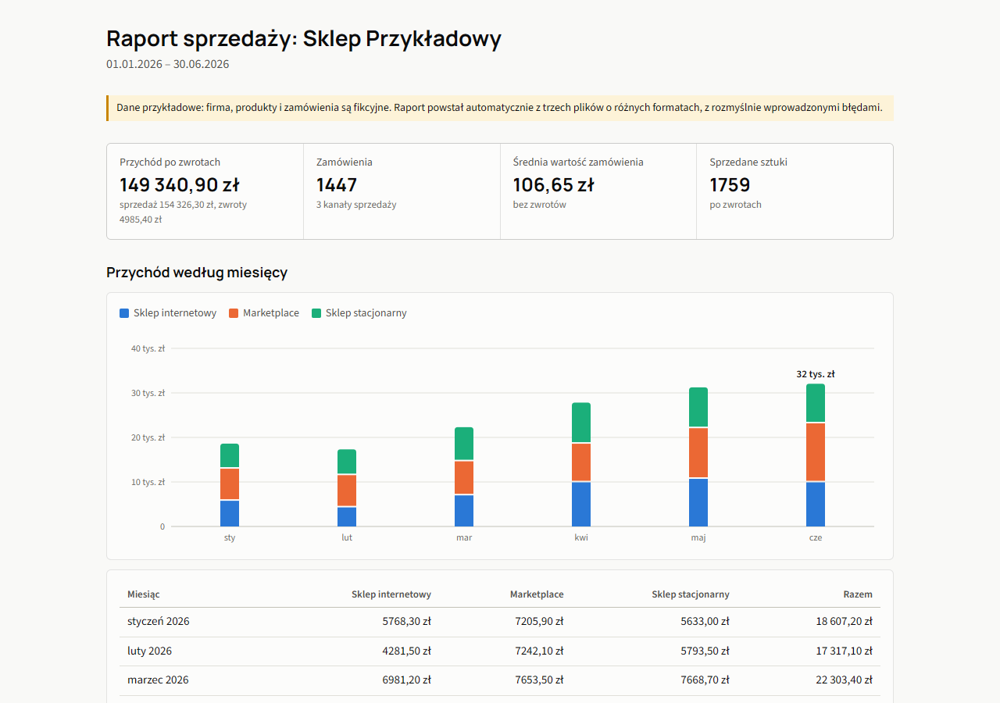

# Automatyczny raport sprzedaży

Skrypt w Pythonie zastępuje ręczne łączenie eksportów sprzedaży. Wczytuje pliki z kilku kanałów, czyści dane i tworzy gotowy raport w Excelu i HTML.

To projekt demonstracyjny. Firma, produkty i zamówienia są fikcyjne.



## Jaki problem rozwiązuje

Każdy kanał sprzedaży eksportuje dane inaczej. W przykładzie są trzy pliki:

| Plik | Format | Typowe problemy |
|---|---|---|
| `sklep_online.csv` | CSV, separator `;`, kodowanie Windows-1250 | ceny `1 234,50 zł`, nadmiarowe spacje, zduplikowane wiersze |
| `marketplace.csv` | CSV, separator `,`, UTF-8 | angielskie kolumny, daty `01.03.2026`, inne nazwy tych samych produktów |
| `kasa_sklep.xlsx` | Excel z nagłówkiem w 4. wierszu | skróty nazw, daty `5 mar 2026`, ceny raz jako liczba, raz jako tekst, wiersz `SUMA` |

Dane zawierają też celowe błędy: nieistniejące daty, puste ceny i ilości w rodzaju „dużo”.

## Co robi

- Rozpoznaje daty i kwoty w różnych formatach, a wartości niejednoznacznych, np. `12,345`, nie zgaduje.
- Łączy różne nazwy tego samego produktu na podstawie listy aliasów w `produkty.csv`.
- Usuwa duplikaty, pomija anulowane zamówienia i odejmuje zwroty.
- Liczy pieniądze w groszach, więc sumy zgadzają się co do grosza.
- Niczego nie usuwa po cichu. Każdy wiersz trafia do raportu, na listę problemów albo do nazwanego licznika.
- Porównuje wynik z sumą podaną w pliku źródłowym i pokazuje różnicę.

## Wynik

`raport.xlsx` ma arkusze:

- **Podsumowanie**: najważniejsze liczby, tabela miesięczna i wykres.
- **Produkty**: ranking, udział w przychodzie i wykres.
- **Dane**: oczyszczone wiersze z filtrem.
- **Problemy**: każdy błąd z numerem wiersza w pliku źródłowym i powodem.
- **Kontrola**: bilans wierszy dla każdego kanału.

`raport.html` to jeden plik z tymi samymi liczbami, który można wysłać mailem.

Gotowy wynik dla danych przykładowych jest w katalogu [`przyklad/wynik`](przyklad/wynik).

## Uruchomienie

Potrzebny jest Python 3.11 lub nowszy.

```powershell
python -m venv .venv
.venv\Scripts\python.exe -m pip install -r requirements.txt
.venv\Scripts\python.exe -m raport --dane przyklad/dane --wyjscie wynik
```

Raport za wybrany okres:

```powershell
.venv\Scripts\python.exe -m raport --dane przyklad/dane --wyjscie wynik --od 2026-04-01 --do 2026-06-30
```

Skrypt można uruchamiać automatycznie, np. co tydzień przez Harmonogram zadań Windows.

## Dostosowanie do innej firmy

Nowy kanał sprzedaży dodaje się w `config.toml`, bez zmian w kodzie:

```toml
[[zrodla]]
nazwa = "Nowy kanał"
plik = "nowy_kanal.csv"
separator = ";"
kodowanie = "utf-8"

[zrodla.kolumny]
numer = "Numer"
data = "Data"
produkt = "Nazwa"
ilosc = "Ilość"
cena = "Cena"
```

Gdy w pliku brakuje kolumny albo plik ma złe kodowanie, skrypt mówi po polsku, co poprawić, zamiast kończyć się błędem programu.

## Testy

```powershell
.venv\Scripts\python.exe -m pip install -r requirements-dev.txt
.venv\Scripts\python.exe -m pytest
```

`przyklad/generuj_dane.py` liczy poprawne sumy, zanim wprowadzi błędy do danych, i zapisuje je w `przyklad/oczekiwane.json`. Testy porównują gotowy raport z tym plikiem.

Na GitHubie testy uruchamiają się przy każdym wypchnięciu kodu, a raport dla danych przykładowych publikuje się potem na GitHub Pages.

## Struktura

```text
raport/            kod programu
  readers.py       odczyt CSV i Excela
  cleaning.py      czyszczenie wierszy i dopasowanie produktów
  pipeline.py      łączenie danych i podsumowania
  excel_report.py  arkusz Excel
  html_report.py   raport HTML
przyklad/          dane przykładowe i ich generator
tests/             testy
docs/              zrzuty ekranu
```
